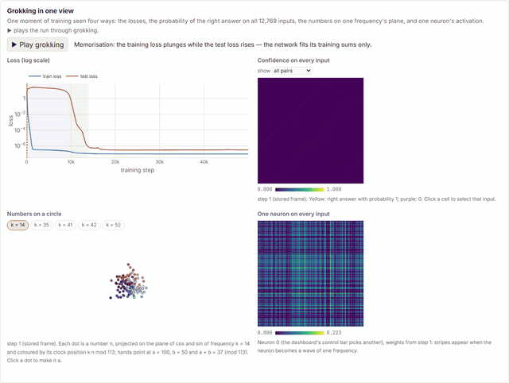
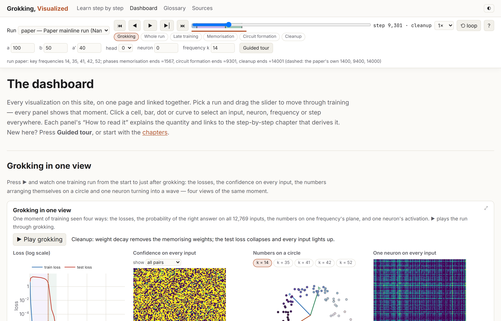
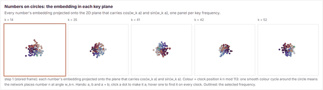
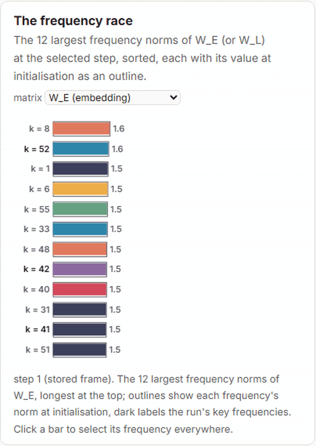
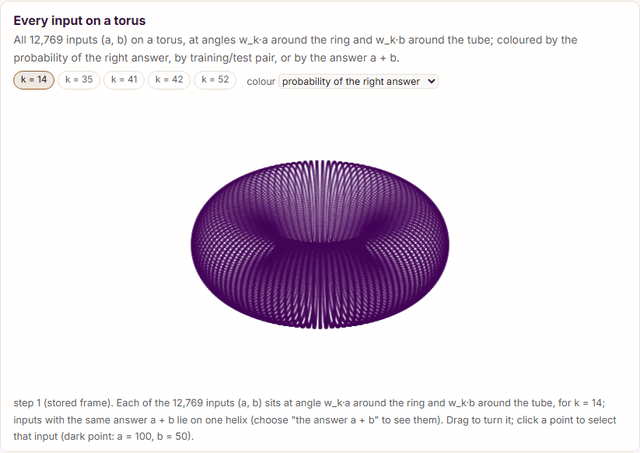
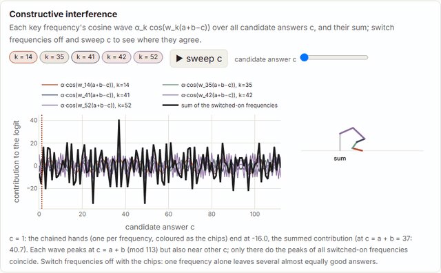

# Grokking, Visualized — modular addition, step by step

An explorable website, and the reproducible pipeline behind it, about the one-layer transformer that *groks*
addition modulo 113. The network was reverse-engineered by Nanda, Chan, Lieberum, Smith & Steinhardt (2023),
[*Progress measures for grokking via mechanistic interpretability*](https://arxiv.org/abs/2301.05217).

- **Website:** <https://burnycoder.github.io/visualizing-grokking-modular-addition/>
  - 22 step-by-step chapters, from "what is a remainder" to the full Fourier-multiplication algorithm;
  - one big dashboard of linked visualizations that you can scrub across training.
- **Models and data:** Hugging Face collection [*Visualizing grokking modular addition*](https://huggingface.co/collections/BurnyCoder/visualizing-grokking-modular-addition-6ad822354f93a379ba50756a). It contains:
  - our 22 runs: [`BurnyCoder/grokking-modular-addition-runs`](https://huggingface.co/BurnyCoder/grokking-modular-addition-runs);
  - the site data: [`BurnyCoder/grokking-modular-addition-site-data`](https://huggingface.co/datasets/BurnyCoder/grokking-modular-addition-site-data);
  - an earlier TransformerLens replication (seed 999): [`BurnyCoder/grokking-modular-addition-transformer`](https://huggingface.co/BurnyCoder/grokking-modular-addition-transformer);
  - the paper's own mainline run: [`callummcdougall/grokking_full_run_data`](https://huggingface.co/callummcdougall/grokking_full_run_data).
- **Reports:** [`reports/`](reports/), with one file per experiment, a [summary of all experiments](reports/summary.md) and a
  paper (`reports/paper.pdf`).






## Methodology

**Question.** Nanda et al. explain one trained network: their "mainline" run. What does that network compute, how does
the computation form during training, and how do we know? We show every step of the evidence on the paper's own network.
We then test the central claims on 11 independently trained seeds plus controls. The tests were preregistered.

**Task and data.**
- **Inputs.** All 113 × 113 = 12,769 pairs (a, b). Each pair is written as the tokens `a b =`, and the label is (a + b) mod 113.
- **Split.** 30 % of the pairs (3,830) are used for training. For the paper run and for our seed 0 the split is the
  paper's own: Python `random.seed(0); random.shuffle(pairs)` (`src/grokviz/task.py`).

**Model.**
- **Architecture.** A one-layer transformer (paper Sec. 3, App. A) with:
  - d_model = 128, 4 attention heads of size 32, an MLP of 512 ReLU neurons;
  - no LayerNorm, untied embedding and unembedding;
  - 226,816 parameters.
- **Implementation.** `src/grokviz/model.py` re-implements it in the paper's exact parameter layout, so the paper's
  checkpoints load with `strict=True`.

**Training** (the paper's settings, Sec. 3, and its released code):
- full-batch AdamW: learning rate 10⁻³, β = (0.9, 0.98), weight decay λ = 1, and a 10-step linear warm-up;
- cross-entropy computed in float64, as in the paper's notebook and ARENA (the released `helpers.py` casts to float32);
- 40,000 steps, as stated in the paper (the released run continued to 50,000), with a checkpoint every 100 steps.

All 22 runs train together on one GPU, vectorised with `torch.func.vmap`. This is deterministic and resumable
(`src/grokviz/train.py`). The run matrix comes from [the preregistration](docs/preregistration.md):

| Group | Runs | What differs | Role |
|---|---|---|---|
| paper | 1 | downloaded from [`callummcdougall/grokking_full_run_data`](https://huggingface.co/callummcdougall/grokking_full_run_data) | the subject of the website |
| `wd1_s0…10` | 11 | init and split seed s; λ = 1 | confirmatory replication |
| `wd0_s0…4` | 5 | λ = 0 | control: no weight decay |
| `rand_s0…2` | 3 | random labels | control: nothing to generalise |
| `split0_init100…102` | 3 | the paper's split, different inits | exploratory: does the data or the init pick the frequencies? |

**Analysis** (`src/grokviz/metrics.py`, `interventions.py`, `patching.py`, `gradients.py`, `geometry.py`).
- **Origin.** The functions are re-implementations of the paper's code, of ARENA 1.5.2 and of this repo's submodule
  notebooks. Each module's docstring links its sources at pinned commits, and [`docs/porting-map.md`](docs/porting-map.md)
  maps every function to its origin.
- **Definitions.** Every metric has an exact definition in [`docs/operationalizations.md`](docs/operationalizations.md).
- **Metrics computed:**
  - Fourier spectra of the weights;
  - restricted and excluded loss;
  - Gini sparsity;
  - single-frequency neurons;
  - the logit cosine fit;
  - frequency ablations with random controls;
  - counterfactual activation patching of the key-frequency subspace;
  - exact full-batch gradients;
  - activation and output-distribution geometry.
- **Validation.** The code was first checked against 30 numbers and claims published by the paper and ARENA, using the paper's
  network ([experiment 1](reports/exp-01-paper-validation.md)).

**Statistics.**
- **Hypotheses.** H1–H5 were fixed before training (git tag `prereg-v1`). They are tested with exact sign tests or a
  Fisher test, with Holm correction across the five.
- **Descriptive results** come with 95 % t or bootstrap intervals.
- **Sample size.** n = 11 seeds was chosen by a power analysis (see the preregistration).

**Website.**
- **Build.** Static HTML generated from `content/` (Markdown with macros) by `src/grokviz/site_build.py`. The build fails if:
  - a term is used before it is defined;
  - a glossary word appears in plain text before its defining chapter without a hover card (`[[preview:…]]`);
  - a relative link or asset in the built pages is missing;
  - a quote is longer than the quote policy allows;
  - a `{{num:key}}` in the prose names a key missing from `site/data/summary.json` (a number typed by hand cannot be
    detected).
- **Quote check.** Separately, `tests/test_quotes.py` checks every quote word for word against its PDF page. It runs
  locally, once `acquire_paper_sources` has downloaded the PDFs.
- **Figures.** Every figure is one JavaScript module, used by both the chapters and the dashboard.
- **In-browser model.** Any per-input view (choose a, b, a neuron or a head) is computed by a JavaScript copy of the
  model from float16 weights. It is tested against PyTorch.
- **Animation.** Playing a run moves through the stored checkpoints. Positions between two checkpoints are interpolated
  only while playing, and figures say so; a paused figure always shows a stored frame and its step.

## Results

See [`reports/summary.md`](reports/summary.md) for all experiments and [`reports/tables/hypotheses.md`](reports/tables/hypotheses.md)
for the preregistered tests. In short:

- **Our analysis code reproduces 26 of 30 published numbers and claims** on the paper's network. The 4 it does not reproduce are
  explained in [experiment 1](reports/exp-01-paper-validation.md).
- **Swapping the key-frequency subspace** of a's embedding with that of a′ moves the paper network's output to a′ + b:
  - recovered: 99.7 % of the logit difference;
  - complement-subspace control: 0.2 %;
  - random-subspace control: 6 %.
- **Seeds and controls (preregistered, 11 seeds):**
  - All 11 seeds with weight decay grok within 40,000 steps; none of the 5 without it does (Fisher p = 2.3 × 10⁻⁴).
  - Supported (11/11 seeds each, Holm-adjusted p = 0.002):
    - restricted loss falls before test loss (H1);
    - excluded loss rises during circuit formation (H2);
    - Fourier sparsity is learned and specific to the Fourier basis (H3).
  - **Not supported:** the strict key-frequency ablation criterion (H4, 6/11). In 2 seeds the weight-norm rule that
    names the key frequencies admits one whose removal costs less than 100× (5.9×, 70×); in 3 seeds the frequencies
    it leaves out jointly cost 1.6–2.8× (limit 1.5×).
  - Patching recovers 0.997 [0.995, 0.998] of the logit difference across seeds.
- **Exploratory:** our seed 0 starts from the paper's initial weights, identical up to float32 rounding (max |Δ| =
  3.0 × 10⁻⁸). It diverges numerically within ~50 steps,
  yet ends with the paper's key frequencies.
- **Exploratory dynamics** (gradients, and Adam's step rebuilt from the saved Adam states). During circuit formation the
  training-loss gradient opposes the test-loss gradient. At the end, Adam's loss step and the weight-decay step are
  nearly equal and opposite. Weight decay outweighs the loss step most within 1,000 steps of grokking in 10 of 11 seeds.

The details are in [exp-02](reports/exp-02-training.md), [exp-03](reports/exp-03-hypotheses.md) and
[exp-04](reports/exp-04-training-dynamics.md).

## What happens when you run it

`uv run grokviz --phases all` runs these phases in order. Every phase logs with timestamps to the terminal and to

```mermaid
flowchart LR
  subgraph Sources
    HF[(HF: paper checkpoints)]
    ARX[(arXiv PDFs, quote checks only)]
  end
  subgraph Pipeline["src/grokviz/pipeline.py"]
    ENV[check_environment] --> ACQ[acquire_paper_sources] --> CONV[convert_paper_run] --> VAL[validate_paper_run]
    VAL --> RC[validate_against_paper]
    RC --> TR[train_all_runs]
    TR --> CM[compute_checkpoint_metrics] --> GR[compute_gradient_dynamics] --> GEO[compute_geometry]
    GEO --> PH[detect_phases] --> FIN[analyse_final_models] --> HYP[test_hypotheses]
    HYP --> PUB[publish_runs_to_hub] --> EXP[export_site_data] --> PSD[publish_site_data]
    PSD --> BUILD[build_site] --> FIG[render_report_figures] --> MED[render_media] --> PDF[build_paper_pdf]
  end
  HF --> ACQ
  ARX --> ACQ
  CONV --> RUNS[(runs/)]
  TR --> RUNS
  RUNS --> CM
  HYP --> REP[(reports/tables)]
  EXP --> DATA[(site/data)]
  BUILD --> SITE[(site/)]
  FIG --> PNG[(reports/figures)]
  MED --> CLIPS[(docs/images/clips, reports/media)]
  PDF --> PAPER[(reports/paper.pdf)]
  PUB --> HFM[(HF model repo)]
  PSD --> HFD[(HF dataset)]
  SITE --> PAGES[GitHub Pages]
```

`logs/<timestamp>_pipeline.log`:



1. **Paper run.**
   - Download the paper's checkpoints, pinned by revision and sha256 (~0.5 GB).
   - Store them in our run format (`runs/paper/`).
   - Check that recomputed training losses match the logged ones; this fixes the split and the step offset.
   - Run the 30 reproduction checks (26 match).
2. **Training.** Train the 22 runs: 73 minutes on an RTX 5070 laptop GPU. Training saves a resume point every
   2,000 steps; if it is interrupted, rerunning the phase continues from there.
3. **Measurement.**
   - Compute every metric at every checkpoint (`runs/<id>/analysis/ckpt_metrics.npz`): 72 minutes for the paper run
     and the 22 runs.
   - Compute exact full-batch gradients and the activation/output geometry.
   - Detect phase boundaries.
   - Run the ablations, random-basis nulls and patching on the final checkpoints.
4. **Hypotheses.** Evaluate H1–H5 exactly as preregistered, and write `reports/tables/hypotheses.{json,md}`.
5. **Publishing.**
   - Upload the runs to Hugging Face.
   - Export the site data: about 640 MB of binary arrays and float16 weights, plus `summary.json`.
   - Upload the site data and pin it in `site-data.lock`.
   - Build `site/` and render the report figures from the site itself (Playwright).
   - Record the clips below from the site (`render_media`): GIFs for this README, MP4s in `reports/media/` and
     5-frame film strips for the paper.
   - Compile the paper (`paper/main.typ` → `reports/paper.pdf`, Typst). Its measured numbers come from the same `summary.json`.

Data formats are documented in [`docs/data-formats.md`](docs/data-formats.md); module responsibilities are in
[`docs/architecture.md`](docs/architecture.md).

## Install and reproduce

**Requirements:**
- [uv](https://docs.astral.sh/uv/) and Git.
- Optional:
  - an NVIDIA GPU with a CUDA 13 driver (training on CPU works but is slow);
  - Node.js (tested with 22 and 24) for the JavaScript parity test.

```bash
git clone --recurse-submodules https://github.com/BurnyCoder/visualizing-grokking-modular-addition
cd visualizing-grokking-modular-addition
uv sync --extra cu130          # NVIDIA GPU; use `uv sync --extra cpu` without one
uv run playwright install chromium   # only for render_report_figures, render_media and browser tests
cp .env.example .env           # optional: every setting has a default in .env.example
```

`render_media` also needs ffmpeg: add `--extra media` to `uv sync` for a bundled one
([imageio-ffmpeg](https://github.com/imageio/imageio-ffmpeg)), or it uses `ffmpeg` on your PATH.

On Windows, cloning into a deep folder can fail with "Filename too long" while Git checks out the submodule, whose
name is long. Add `-c core.longpaths=true` after `git` in the clone command, or clone into a shorter path.

**Run the whole pipeline**, or any subset of phases:

```bash
uv run grokviz --phases all
```

```bash
uv run grokviz --phases compute_checkpoint_metrics,compute_geometry --runs wd1_s0 --force
```

The CLI flags:
- `--phases`: phases to run;
- `--skip`: phases to leave out;
- `--runs`: runs to process, as exact ids (`wd1_s1`) or groups (`wd1`). Phases that aggregate or publish all runs
  ignore it: `test_hypotheses`, `export_site_data`, `publish_runs_to_hub`, `publish_site_data`, `build_site`,
  `render_report_figures`, `render_media` and `build_paper_pdf`;
- `--force`: recompute existing outputs;
- `--verbose`: also log DEBUG messages.

The two publishing phases need a Hugging Face login (`hf auth login`); skip them with
`--skip publish_runs_to_hub,publish_site_data`.

**Only view the website (no torch, no GPU, no training).** Download the published site data into `site/`, then build and serve it:

```bash
uv sync --no-dev
uv run python -c "import json; from huggingface_hub import snapshot_download as s; l=json.load(open('site-data.lock')); s(l['repo'], repo_type='dataset', revision=l['revision'], local_dir='site', allow_patterns='data/*')"
uv run python -m grokviz.site_build
uv run python -m grokviz.serve --dir site --port 8766
```

Then open <http://localhost:8766>.

**Tests:**
- The fast suite runs on CPU (this is what CI runs):

  ```bash
  uv run pytest -m "not gpu and not network and not slow and not browser"
  ```

- The full suite needs a GPU, internet access and Chromium:

  ```bash
  uv run pytest
  ```

- Two of the tests check the built site and its data: `tests/test_site_data.py` (every array matches its manifest
  entry, plus the [1 GB Pages limit](https://docs.github.com/en/pages/getting-started-with-github-pages/github-pages-limits)) and `tests/test_site_browser.py`. The browser test opens every page in headless
  Chromium, waits for every figure to draw, fails on console errors, and checks the dashboard's first paint is under 3 s.
  Both are skipped until `site/` has been built with data.

**Configuration.** All settings are environment variables with defaults in [`.env.example`](.env.example), covering
seeds, steps, logging intervals, paths, pinned revisions and Hugging Face repo ids. Put overrides in `.env`, which is gitignored.

## Features

- **22 chapters** with these properties:
  - every term is defined before it is used, with tooltips;
  - every symbol has a one-sentence card;
  - each chapter has worked examples with p = 5 and with the real p = 113;
  - quotes are exact and verified against the PDF page;
  - figures and widgets are interactive.
- **Dashboard** with a hero panel ("Grokking in one view") and 8 panel groups:
  - training curves, weights, activations, geometry, output for (a, b), gradients, interventions, and seeds/controls;
  - one control bar (run, step, a, b, a′, head, neuron, frequency), with the state kept in the URL;
  - a player: play/pause, ¼× to 8× speed (1× = 10 checkpoints per second), loop, ranges (the grokking window, the
    whole run, the late phase, each phase), keyboard shortcuts;
  - a 15-step guided tour, 7 of whose steps play a stretch of training.
- **76 figures and 19 teaching widgets**, each one module shared by the chapters and the dashboard:
  - figures off screen do not redraw, and a figure whose stored frame did not change skips the redraw;
  - chapter animations (`{{anim:id}}`) play when scrolled into view; scrollytelling scenes drive the page's player,
    and in chapter 5 the forward pass stays pinned while each step section lights up its stage;
  - 3D panels (inputs on a torus, three principal components) drawn by a small canvas renderer;
  - an ablation playground: remove or keep frequencies and see loss, accuracy and the correctness grid change;
  - every figure can be enlarged; `prefers-reduced-motion` (or `?still=1`) turns off autoplay and tweening.
- **In-browser model.** Per-input attention, neuron and logit views come from the real weights at any stored checkpoint,
  computed in a web worker.
- **Clips.** Five short recordings of the site, made by the pipeline (see below).
- **Reproducible pipeline:**
  - pinned inputs;
  - deterministic, resumable batched training;
  - a preregistration;
  - prose numbers bound to the analysis output (`{{num:key}}`).
- **Reports and paper** generated from the same data and figures.

**Clips.** `render_media` records these from the dashboard. Each frame is a stored checkpoint of the paper's run (every
200 steps from step 1 to 15,401), and the interference clip sweeps the candidate answer at step 40,001. The hero clip is
at the top of this page; MP4 versions are in [`reports/media/`](reports/media/).

| Numbers settle onto circles | The frequency race |
|---|---|
|  |  |
| **Every input on a torus** | **Constructive interference** |
|  |  |

## Technologies

- **Pipeline:** Python 3.12, uv, PyTorch 2.14 (CUDA 13.0), `torch.func.vmap`, NumPy, SciPy, safetensors, python-dotenv,
  huggingface_hub, PyMuPDF (quote checks).
- **Website:** Jinja2 and markdown-it-py (static build), Plotly.js 4.1.2 and KaTeX 0.19.0 (from jsDelivr), plain ES
  modules, a web worker, and canvas heatmaps, scatter plots and 3D point clouds (no WebGL).
- **Figures, clips, paper and CI:** Playwright (figures and clips rendered from the site), ffmpeg via imageio-ffmpeg
  (MP4, GIF, film strips), Typst (paper PDF), GitHub Actions and Pages, and Hugging Face Hub.

## Repository layout

| Path | Content |
|---|---|
| `src/grokviz/` | the pipeline: `pipeline.py` (single wrapper) → one module per phase |
| `content/` | chapters (Markdown), glossary, symbols, quotes, references, figure and dashboard metadata |
| `templates/`, `web/` | HTML templates; CSS and JavaScript (figures, widgets, in-browser model) |
| `tests/` | pytest suite and the JavaScript parity test |
| `docs/` | preregistration, metric definitions, architecture, data formats, porting map, content style, deployment |
| `reports/` | experiment reports, summary, tables, figures, paper |
| `ai-mechanistic-interpretability-transformer-modular-addition-grokking/` | git submodule with the original notebooks (reference only) |

Coding-agent conventions are in [`AGENTS.md`](AGENTS.md); deployment is described in [`docs/deployment.md`](docs/deployment.md).

## Sources and license

- **Third-party material.** The paper (arXiv:2301.05217), the paper's checkpoints and code, ARENA 1.5.2, Power et al.
  (2022) and the three videos used as framing (Nanda & Smith, Nanda & Chan, Welch Labs) are credited throughout. Their
  terms are listed in [`NOTICE.md`](NOTICE.md).
- **License.** Our code and text are MIT ([`LICENSE`](LICENSE)).
- **Author.** Libor Burian.
