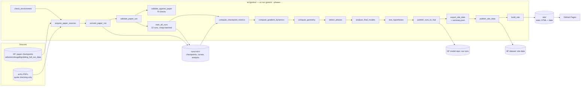

# Architecture

## Data flow

## Layers

| Layer | Files | Responsibility |
|---|---|---|
| Wrapper | `pipeline.py`, `__main__.py` | ordered registry of phases; CLI (`--phases`, `--runs`, `--force`, `--skip`) |
| Settings & logs | `config.py` (+ `.env.example`), `logs.py`, `context.py`, `envcheck.py` | typed config from .env files; timestamped file+terminal logging; provenance |
| Core math | `task.py`, `model.py`, `losses.py`, `fourier.py` | dataset/split, paper-layout transformer with hooks, float64 losses, Fourier basis, Gini |
| Runs | `runstore.py`, `sources.py`, `train.py` | on-disk run format; paper checkpoints; resumable vmap-batched training |
| Analysis | `metrics.py`, `interventions.py`, `patching.py`, `checkpoint_metrics.py`, `gradients.py`, `geometry.py`, `phases.py`, `rchecks.py`, `hypotheses.py`, `stats.py` | every measurement on the site and in the reports |
| Output | `export.py`, `summary.py`, `site_build.py`, `quotes.py`, `hf_publish.py`, `serve.py` | binary site data, prose numbers, HTML build with content checks, quote verification, Hub uploads, preview server |
| Website | `content/`, `templates/`, `web/` | chapters/glossary/symbols/quotes/figures metadata; Jinja templates; ES-module figures, widgets, in-browser model |

## Design choices (and why)

- **No TransformerLens.** TransformerLens 4.x removed `HookedTransformer`; a ~150-line model with the paper's exact
  parameter layout loads the paper's checkpoints without conversion and is mirrored line by line in JavaScript.
- **Batched training.** The model is tiny, so one run leaves the GPU idle; all 22 runs train together with
  `torch.func.vmap` (runs provably independent, see `tests/test_train.py`), ~70 minutes instead of ~7.5 hours.
- **Static site, one implementation per figure.** Figures are ES modules registered by id; chapters and the
  dashboard place the same implementation, so the step-by-step text and the dashboard cannot disagree.
- **Numbers are bound, not typed.** Every number in the prose comes from `site/data/summary.json` via `{{num:key}}`.
- **Heavy compute in Python, per-input compute in the browser.** Curves, spectra and geometry are precomputed; any
  (a, b) / neuron / head view is computed from float16 weights by `web/js/model/grokmodel.js` (tested against torch).
